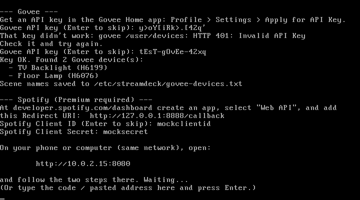
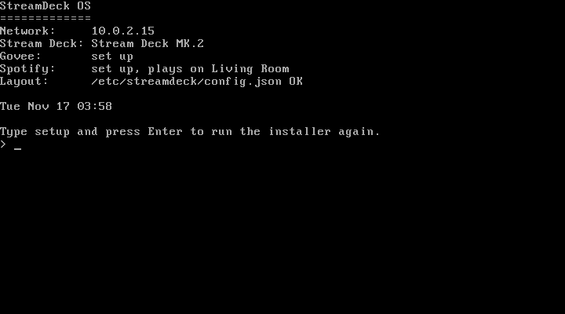

# StreamDeck OS

A tiny Linux appliance OS (Buildroot) for a Raspberry Pi with one job: you press a
key on an **Elgato Stream Deck MK.2**, and it applies **Govee** lighting scenes and
starts **Spotify** playlists on another device (a Spotify Connect speaker, PC, TV…).

- Boots straight into the app. No desktop, no login prompt.
- A **first-boot installer** on the HDMI screen asks for the Wi-Fi, the Govee API key
  and the Spotify developer app credentials, then logs you in to Spotify.
- The console keyboard layout is **Dvorak** (US).
- The button layout is a JSON file on the SD card's boot partition, so you can edit it
  from any computer.

| Installer (Spotify step) | Status screen after install | Deck (virtual MK.2 in the VM test) |
|---|---|---|
|  |  |  |

## What you need

- Raspberry Pi 4 (default), 5 or 3B/3B+, a microSD card (≥ 512 MB), an HDMI screen and a USB keyboard for the installer
- Stream Deck MK.2 (USB IDs `0fd9:0080`, and `0fd9:00a5` for the scissor-key revision)
- **Govee API key**: Govee Home app → Profile → ⚙ Settings → *Apply for API Key* (it arrives by email)
- **Spotify Premium** (playback control in the Web API is Premium-only), plus a Spotify developer app:
  1. Go to <https://developer.spotify.com/dashboard> → *Create app*
  2. Tick **Web API**
  3. Add the Redirect URI **exactly**: `http://127.0.0.1:8888/callback`
  4. Copy the **Client ID** and **Client Secret** (you type them into the installer)

## Why Spotify needs the developer key *and* a login

The Client ID and Client Secret identify your app. Spotify only allows a logged-in
user to start or pause playback and to pick the speaker, so the installer also does a
one-time login:

1. You type the Client ID and Client Secret on the console.
2. The screen shows `http://<pi-ip>:8080`. Open it on your phone.
3. Tap **Log in with Spotify**, then **Agree**.
4. You land on a `127.0.0.1` page that won't load. That's expected: Spotify only
   allows `http` redirects to loopback addresses.
5. Copy that page's address and paste it into the box on the setup page.
6. The device swaps it for a long-lived refresh token, which it renews by itself.
   You won't need to log in again.
7. Pick the default speaker from the list. Spotify must be open on that speaker
   (or have played recently) to show up.

## Build and flash

On Linux (Debian/Ubuntu) with Buildroot's [usual host packages](https://buildroot.org/downloads/manual/manual.html#requirement-mandatory):

```sh
make rpi4            # or rpi5 / rpi3; the first build takes about an hour
# write output/rpi4/images/sdcard.img to the SD card, e.g.:
sudo dd if=output/rpi4/images/sdcard.img of=/dev/sdX bs=4M conv=fsync
```

Boot the Pi with the screen, the keyboard and the Stream Deck attached, and follow the
installer. To run it again later, type `setup` and press Enter on the status screen.

## Button layout

Edit `streamdeck/config.json` on the SD card's boot partition (it's FAT, so any PC can
read it). The daemon notices changes within a few seconds. The installer also writes
`streamdeck/govee-devices.txt` there, listing the exact device names and scene names
for your account.

The MK.2 keys are numbered 0–14, left to right, top to bottom:

```
 0  1  2  3  4
 5  6  7  8  9
10 11 12 13 14
```

```json
{
  "brightness": 70,
  "idle_dim_seconds": 600,
  "pages": {
    "home": [
      { "key": 1, "label": "Party", "color": "#b0186e", "icon": "icons/party.png",
        "actions": [
          { "type": "govee_scene", "device": "TV Backlight", "scene": "Party" },
          { "type": "spotify_playlist",
            "playlist": "https://open.spotify.com/playlist/37i9dQZF1DXaXB8fQg7xif",
            "shuffle": true, "volume": 60 }
        ] },
      { "key": 4, "label": "Music >", "actions": [ { "type": "page", "page": "music" } ] }
    ],
    "music": [ { "key": 4, "label": "< Back", "actions": [ { "type": "page", "page": "home" } ] } ]
  }
}
```

A button's actions run in order. If Govee fails, the Spotify actions still run.
While a button works, its key shows a yellow border. Green means it worked; red with
"ERROR" means something failed, and the details are in `/var/log/messages`.

| action `type` | fields |
|---|---|
| `govee_scene` | `device`, `scene` (a dynamic scene name as shown in the Govee app) |
| `govee_diy_scene` | `device`, `scene` (one of your DIY scenes) |
| `govee_power` | `device`, `on` (`true`/`false`) |
| `govee_brightness` | `device`, `brightness` (1–100) |
| `govee_color` | `device`, `color` (`#rrggbb`) |
| `spotify_playlist` | `playlist` (a `spotify:` URI or an open.spotify.com link to a playlist, album or artist), optional `spotify_device`, `shuffle`, `volume` |
| `spotify_pause` / `spotify_next` | optional `spotify_device` |
| `spotify_volume` | `volume` (0–100), optional `spotify_device` |
| `page` | `page` |
| `delay` | `ms` |

`spotify_device` falls back to the default speaker picked in the installer. Button
fields are `key`, `label`, `color`, `text_color` and `icon` (a PNG/JPEG path relative
to config.json).

## How it fits together

```
app/                      Go, one static binary: streamdeckd
  cmd/streamdeckd         run (daemon) | console (tty1 installer + status) | setup | check | press …
  internal/deck           Stream Deck MK.2 driver over raw /dev/hidraw (no libusb/hidapi)
  internal/govee          Govee Developer API (openapi.api.govee.com/router/api/v1)
  internal/spotify        Spotify Web API (refresh-token auth, Connect device control)
  internal/setup          first-boot installer + phone page for the Spotify login
  internal/render         key images (Go font, icons, press feedback)
  testtools/              virtual MK.2 (uhid) + mock Govee/Spotify used by the VM test
buildroot-external/       BR2_EXTERNAL tree: package, defconfigs, rootfs overlay, boot scripts
config/                   example button layout
test/vm/                  QEMU end-to-end test
```

Boot sequence: load the Dvorak keymap → mount `/boot` → Ethernet DHCP → Wi-Fi (if set
up) → chrony (the Pi has no clock battery, and TLS needs the right time). Then init
starts `streamdeckd console` on tty1 and `streamdeckd run` under respawn. The secrets
live in `/var/lib/streamdeck/secrets.json` (mode 0600) on the root filesystem, not on
the FAT partition.

## Testing

```sh
make test       # unit tests: config, MK.2 protocol, Govee/Spotify clients, installer flow
make vm-test    # full end-to-end run in QEMU
```

The VM test boots an Ubuntu kernel with busybox and the **real** `streamdeckd` binary,
keymap script and keymap data. It also creates a **virtual Stream Deck MK.2** through
Linux `uhid`, which shows up as a genuine `/dev/hidraw` device with ID `0fd9:0080`, so
the real driver code runs unchanged. Then it:

- types into the installer through the VM's emulated keyboard: first in QEMU's US-QWERTY key positions (must be rejected), then by Dvorak key positions (must be accepted)
- completes the Spotify login through the phone page on :8080
- checks that the daemon loads the settings, uploads 72×72 JPEGs to all 15 keys and sets the brightness
- presses keys and checks the exact Govee and Spotify requests that come out

Govee and Spotify are mocked in the VM, so the test needs no accounts and no internet.

## Limits

- Supports the Stream Deck MK.2 only. Other models are recognised and refused.
- The Spotify target speaker has to be online and visible to Spotify Connect when the button is pressed.
- The Govee calls go through Govee's cloud API (10,000 requests a day per key), not LAN control.
