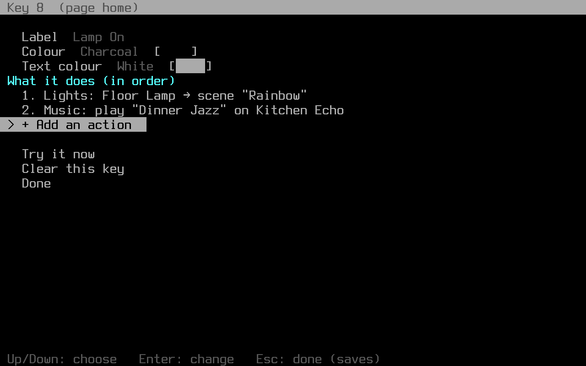

# StreamDeck OS

A tiny Linux OS for an x86 **mini PC** with one job: you press a key on an **Elgato
Stream Deck MK.2**, and it applies **Govee** lighting scenes and starts **Spotify**
playlists on another device (a Spotify Connect speaker, PC, TV…).

- Ships as an **installer ISO**. The USB stick does one thing: install (or update) StreamDeck OS on the mini PC's disk. No keys, passwords or buttons are asked for there.
- Everything else happens on the **installed system's home screen**: a graphical app on the HDMI screen, used with the keyboard (**Dvorak** layout) and its **trackpad** or any mouse. Connect Wi-Fi, add your Govee key, connect Spotify, then set up your buttons.
- The system boots in about 20 s and runs entirely from RAM. Settings are kept on the disk.

| Home screen | Button editor (inside a folder) | Editing a key | Deck |
|---|---|---|---|
|  |  |  |  |

## Before you start

- **Mini PC** (x86_64 with UEFI) plus an HDMI screen and a USB keyboard. A keyboard with a built-in trackpad works well; a USB mouse works too. Networking is **Wi-Fi only**, built-in or a USB dongle (see [Wi-Fi](#wi-fi)). Wired Ethernet is not supported: the image has no Ethernet drivers.
- **Secure Boot must be off** in the mini PC's firmware setup (usually Del/F2 at power-on), because the boot loader isn't signed.
- **The install erases the disk you choose**, Windows included.
- **Stream Deck MK.2**: USB ID `0fd9:0080`, or `0fd9:00a5` for the scissor-key revision.
- **Govee API key**: Govee Home app → Profile → ⚙ Settings → *Apply for API Key* (it arrives by email).
- **Spotify Premium**: the Web API only controls playback for Premium accounts.
- **A Spotify developer app** (this is where the Client ID and Secret come from):
  1. Go to <https://developer.spotify.com/dashboard> → *Create app*
  2. Tick **Web API**
  3. Add the Redirect URI **exactly**: `http://127.0.0.1:8888/callback`
  4. Copy the **Client ID** and **Client Secret**

## Install

1. Put `streamdeck-os.iso` on a USB stick with any of: [balenaEtcher](https://etcher.balena.io/), Rufus (either mode), `dd`, or [Ventoy](https://www.ventoy.net/) (just copy the `.iso` onto the stick).
2. Plug in the stick and the keyboard, then boot from USB (the boot menu key is often F7, F11 or F12).
3. Choose **Install StreamDeck OS**, pick the disk, and confirm **Erase and install**.
4. Remove the stick when asked and restart. The installer has already added a "StreamDeck OS" UEFI boot entry and put it first.


## First start: the home screen

After the restart the home screen shows four status cards (Wi-Fi, Stream Deck, Lights,
Music) and a **Getting started** checklist. Use the arrow keys and Enter, or click with
the trackpad:

1. **Wi-Fi**: pick your network from the list and type the password (**Show** reveals what you typed, handy with Dvorak).
2. **Lights**: type your Govee API key. It's checked on the spot and your lights are listed.
3. **Music**: type the Spotify Client ID and Secret. The screen then shows an address like `http://192.168.1.42:8080`; open it on your phone (same Wi-Fi), tap *Log in with Spotify*, then *Agree*. You land on a `127.0.0.1` page that won't load. That's expected: Spotify only allows `http` redirects to the local machine. Copy that page's address and paste it into the phone page (or choose **Type the code** on the mini PC). Then pick the **default speaker**; Spotify must be open on it to appear.
4. **Buttons**: set up your Stream Deck (see [Editing your buttons](#editing-your-buttons)).

| Spotify login | Wi-Fi |
|---|---|
|  |  |

The other tiles: **Setup file** (save or load your settings on a USB stick, below) and
**System** (version, network address, restart, power off). Each change is checked against
the service before it's saved, and takes effect within seconds.
**Ctrl+Alt+F2** opens a maintenance shell.

## Skip the typing: a setup file

Put your Wi-Fi, Govee key and Spotify keys in a text file named
**`streamdeck-setup.txt`** on a USB stick. Plug the stick into the installed mini PC
and the home screen shows **"Setup file found on a USB stick"** with a **Use it**
button: it joins Wi-Fi, checks the Govee key and Spotify login, and saves them.

- **One USB port is enough:** the file can sit on the installer stick itself if that stick is writable: **Rufus** in its default "ISO image" mode, or **Ventoy**. Leave it plugged in after installing (or plug it back in) and the home screen offers the file. Sticks made with **balenaEtcher / `dd`** are read-only, so use another stick for the file.
- **Starting point:** the ISO includes `streamdeck-setup.example.txt`, or copy this:

  ```
  wifi_name = MyWifi
  wifi_password = my wifi password
  wifi_country = US
  govee_api_key = 12345678-abcd-...
  spotify_client_id = 0123456789abcdef...
  spotify_client_secret = fedcba9876543210...
  spotify_refresh_token =
  spotify_speaker = Living Room
  ```
- **Let the mini PC write it:** on a set-up mini PC choose **Setup file → Save settings to a USB stick**. That includes your Spotify login (`spotify_refresh_token`), so after a reinstall no phone login is needed either. **Setup file → Load settings from a USB stick** reads it back.
- **Empty values** are simply skipped: set those up on screen.
- **Windows quirks are fine:** a name like `streamdeck-setup.txt.txt` (Windows hiding the extension) and Windows line endings both work.

The file holds your keys in plain text, so keep that stick somewhere safe, or delete the file after using it.

## Wi-Fi

Built-in Wi-Fi and most USB Wi-Fi dongles work. The image uses Linux 7.0 (Ubuntu's HWE
kernel) with firmware for these chip families:

| Maker | Common dongle chips |
|---|---|
| Realtek | RTL8188/8192 EU/FU, RTL8723BU/DU, RTL8811/8821CU, RTL8812/8821AU, RTL8814AU, RTL8812/8822BU, RTL8851BU, RTL8852AU/BU/CU |
| MediaTek / Ralink | MT7601U, MT7610U/MT7612U, MT7921AU, MT7925U, RT2870/RT3070/RT5370/RT5572 |
| Qualcomm Atheros | AR9271 / AR7010 (e.g. TP-Link TL-WN722N v1), AR9170 |
| Intel / Broadcom | built-in cards (AX200/201/210/211, BE200, 9560 …), Broadcom USB |

Many cheap dongles, including generic "AC600 Mini" Realtek sticks (RTL8811CU), first
show up as a virtual CD-ROM holding Windows drivers (USB ID `0bda:1a2b`). Windows
ejects that CD automatically, and StreamDeck OS now does the same (like Linux's
`usb_modeswitch`). The dongle then re-appears as a Wi-Fi adapter a few seconds later.

Some of those AC600 sticks (USB ID `0bda:c811`) use an antenna layout ("RFE type 7")
that the stock Linux driver rejects with `rfe 7 isn't supported`. The image rebuilds
that one driver (`rtw88_8821c`) with a one-line patch, `os/kernel-patches/rtw88-8821c-rfe7.patch`,
that treats it like the already-supported type 2, as the
[siamsamix/rtw88](https://github.com/siamsamix/rtw88) fork does (tested there on the same
`0bda:c811` hardware). The build checks the patched driver against Ubuntu's own build
of the same source.

You can plug the dongle in at any time, including after boot. The system notices it
within a few seconds and connects. If it has more than one Wi-Fi adapter, it uses the
USB one.

The **Wi-Fi** tile lists nearby networks to pick from (**Join a hidden network…** for
hidden ones). When something fails, it says what went wrong:

- **No Wi-Fi adapter found**: the screen shows the USB ID of any device that has no driver (e.g. `0bda:b812`) and any firmware file that's missing. Send that line to whoever builds your ISO so support can be added.
- **Wrong password**: check what you typed; remember the keyboard is Dvorak.
- **Couldn't find the network**: many dongles are 2.4 GHz only, so try your router's 2.4 GHz network name.
- **Joined but no address**: the router's DHCP didn't answer.

## Editing your buttons

Open **Buttons** on the home screen. The deck is drawn on screen with your real key
images, and the Stream Deck itself shows your changes live.

| Folder in the editor | Picking a scene |
|---|---|
|  |  |

- **Choose a key:** click it, press it on the Stream Deck, or use the arrow keys. While the editor is open, pressing a deck key selects it instead of running it.
- **Edit a key:** click it again, press **Enter**, or click **Edit key**:
  - its label and colours
  - what it does, in order. **Lights** actions (scene, on/off, brightness, colour) let you pick a light and scene from your Govee account. **Music** actions (play a playlist, pause, next, volume) let you pick a playlist and speaker from your Spotify account. **Folders** opens another set of 15 keys. **Wait a moment** pauses between actions.

  Long lists filter as you type.
- **Folders:** select an empty key and click **New folder here** (or press **N**). The folder gets a **‹ Back** key automatically and opens right away so you can fill it. To go into a folder while editing, **double-click** it, **press it twice** on the Stream Deck, click **Open folder**, or press **O**. **Esc** or **Back** goes up one level; the title shows where you are (*Buttons › Lights*). **Folders** lists them all (open, rename, delete, choose which one the deck starts on).
- **Saving:** leaving a key saves it, after checking it. If something can't work, for example a Govee action with no Govee key, the editor says why and offers to undo.
- **Shortcuts:** **T** tries the selected key right now, **Del** clears it, **C** / **V** copy and paste a key, **D** sets deck brightness and dimming, **Esc** goes up a folder or leaves the editor.
- **Playlist permission:** listing your playlists needs one more Spotify permission than playing them. If you logged in before this existed, the playlist picker offers **Reconnect Spotify**, a one-time login on your phone. You can always type a playlist link instead.

The layout is saved in `streamdeck/config.json` on the mini PC's disk. That file never contains your keys or Spotify login.

## Updating

Boot the new ISO's USB stick on the mini PC. When it finds StreamDeck OS already
installed, it offers **Update StreamDeck OS** first. That replaces only the system files; your keys,
Wi-Fi and buttons stay. Remove the stick and restart.

Settings are written straight to disk, and the disk is checked and repaired at every
boot, so unplugging the mini PC right after a change doesn't lose it.

## Layout file reference (advanced)

The editor writes this file for you. For reference, the MK.2 keys are numbered 0–14,
left to right, top to bottom, and each action looks like this:

| action `type` | fields |
|---|---|
| `govee_scene` / `govee_diy_scene` | `device`, `scene` |
| `govee_power` | `device`, `on` (`true`/`false`) |
| `govee_brightness` | `device`, `brightness` (1–100) |
| `govee_color` | `device`, `color` (`#rrggbb`) |
| `spotify_playlist` | `playlist` (a `spotify:` URI or an open.spotify.com link to a playlist, album or artist), optional `spotify_device`, `shuffle`, `volume` |
| `spotify_pause` / `spotify_next` | optional `spotify_device` |
| `spotify_volume` | `volume` (0–100), optional `spotify_device` |
| `page` | `page` |
| `delay` | `ms` |

A button's actions run in order. If Govee fails, the Spotify actions still run.
While a button works, its key shows a yellow border. Green means it worked; red with
"ERROR" means something failed, and the details are in `/var/log/messages`.

## Build the ISO yourself

```sh
make iso          # on Ubuntu 24.04 → .iso/streamdeck-os.iso (~160 MB, builds in under a minute)
make docker-iso   # from any OS with Docker
```

The ISO contains:
- the Ubuntu 24.04 HWE kernel (Linux 7.0)
- busybox
- `wpa_supplicant`
- `streamdeckd` (Go, in `app/`): the deck daemon and the graphical app, drawn straight on the framebuffer (no X or Wayland)
- kernel modules trimmed to USB, keyboard, touchpad/mouse, storage (NVMe, SATA, eMMC, USB sticks) and Wi-Fi drivers; no Ethernet
- Wi-Fi firmware: every file the included Wi-Fi drivers ask for, plus the Wi-Fi regulatory database

## Disk layout

The installer creates a GPT disk with a single 1 GB EFI System Partition labelled `STREAMDECK`:

```
EFI/BOOT/BOOTX64.EFI          GRUB, finds the partition by a marker file
streamdeck/boot/              vmlinuz, initrd.img, installed.cfg
streamdeck/config.json        button layout
streamdeck/state/             secrets.json (API keys, Spotify token), wpa_supplicant.conf
```

## Tests

```sh
make test       # unit tests (config, MK.2 protocol, Govee/Spotify clients, app screens, editor and folders, GPT, UEFI entry)
make iso-test   # full end-to-end run in QEMU (needs qemu-system-x86, ovmf, mtools, fdisk, netpbm, hostapd)
make wifi-test  # the same with no network at all, then a virtual USB Wi-Fi dongle
make modeswitch-test  # a "driver CD" dongle plugged in after boot gets ejected into Wi-Fi mode
make media-test       # install from sticks made with Rufus "ISO mode" and Ventoy; refuse without touching the disk otherwise
make seed-test        # set up the installed system from a setup file with nothing typed (one-port Ventoy stick, Wi-Fi); save it back
```

`iso-test` builds a test ISO, then runs a virtual mini PC: UEFI firmware (OVMF), a USB
stick, a USB keyboard with a "trackpad" (QEMU's USB mouse), an NVMe disk and QEMU's
virtio network card (built into the kernel, so it works even though the image has no
Ethernet drivers). It also adds a **virtual Stream Deck MK.2**, created with Linux
`uhid`. That device is a real `/dev/hidraw` device, so the real driver code runs
unchanged. Govee and Spotify are replaced by a mock server inside the VM. The app writes
`UI:` lines naming each screen and its rows, so the test finds things by label. The test:

1. boots the ISO from the USB stick, checks the drivers and the graphical screen, and installs to NVMe with menu choices only (nothing typed)
2. checks the GPT, the partition label and the files on it, and that no keys are stored yet
3. reboots from NVMe with the stick removed and sets up Govee on the home screen by typing on the USB keyboard by physical key position: QEMU-typed QWERTY positions must be rejected, Dvorak positions accepted
4. opens Music with a trackpad click and completes the Spotify login through the phone page
5. opens the button editor with a trackpad click, makes a folder from a deck key press, builds a key inside it from the account's lights and scenes, tries it, goes up and back into the folder (double press on the deck), and checks the saved layout
6. presses deck keys and checks the exact Govee and Spotify requests, including the folder and its Back key
7. changes the default speaker, cuts the power, and checks the disk
8. boots the stick again, updates in place, and checks that settings and buttons survived

`wifi-test` runs the same virtual mini PC with no network card at all. Its Wi-Fi "dongle" and home
router are virtual radios made by the kernel's `mac80211_hwsim`; the router runs
`hostapd` (WPA2) and DHCP. The test:

1. installs (no network needed)
2. checks that the Wi-Fi screen explains there's no Wi-Fi adapter
3. plugs the dongle in, chooses Look again, and picks the network from the scan list
4. checks that a wrong password is reported as a wrong password
5. connects with the right password and sets up Govee and Spotify over Wi-Fi
6. reboots with the dongle showing up 5 s late, and checks that it reconnects on its own and the deck works

## Limits

- Supports the Stream Deck MK.2 only. Other models are recognised and refused.
- Needs UEFI with Secure Boot off.
- The Spotify target speaker has to be online and visible to Spotify Connect when the button is pressed.
- The Govee calls go through Govee's cloud API (10,000 requests a day per key).
