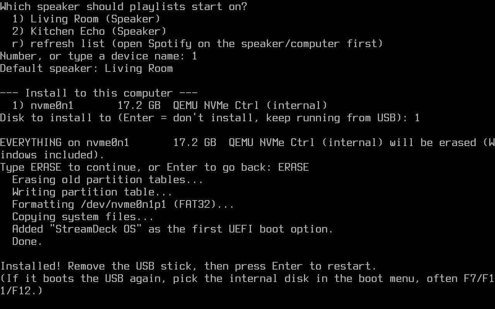
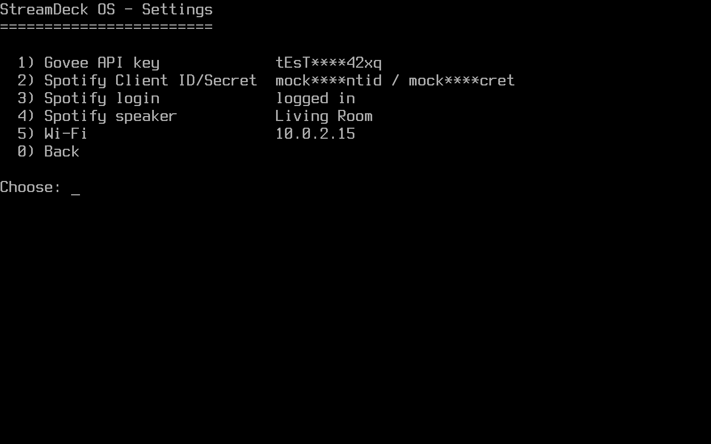
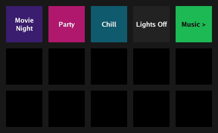
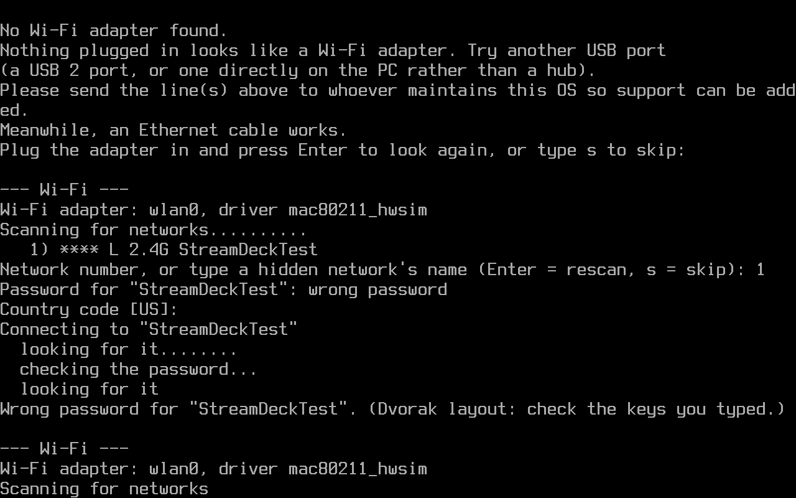

# StreamDeck OS

A tiny Linux OS for an x86 **mini PC** with one job: you press a key on an **Elgato
Stream Deck MK.2**, and it applies **Govee** lighting scenes and starts **Spotify**
playlists on another device (a Spotify Connect speaker, PC, TV…).

- Ships as an **installer ISO**: write it to a USB stick, boot the mini PC from it, answer the questions, and it installs itself to the internal disk.
- The installer and the **Settings** menu run on the HDMI screen with a **Dvorak** keyboard layout. They ask for the Govee API key, the Spotify Client ID and Secret, the Spotify login, the default speaker and Wi-Fi.
- The system boots in about 20 s and runs entirely from RAM. Settings are kept on the disk.

| Installer: Spotify step | Installer: install to disk | Settings menu | Deck |
|---|---|---|---|
|  |  |  |  |

## Before you start

- **Mini PC** (x86_64 with UEFI) plus an HDMI screen and a USB keyboard for the installer. Networking is **Wi-Fi only**, built-in or a USB dongle (see [Wi-Fi](#wi-fi)). Wired Ethernet is not supported: the image has no Ethernet drivers.
- **Secure Boot must be off** in the mini PC's firmware setup (usually Del/F2 at power-on), because the boot loader isn't signed.
- **The install erases the disk you choose**, Windows included.
- **Stream Deck MK.2**: USB ID `0fd9:0080`, or `0fd9:00a5` for the scissor-key revision.
- **Govee API key**: Govee Home app → Profile → ⚙ Settings → *Apply for API Key* (it arrives by email).
- **Spotify Premium**: the Web API only controls playback for Premium accounts.
- **A Spotify developer app** (this is where the Client ID and Secret come from):
  1. Go to <https://developer.spotify.com/dashboard> → *Create app*
  2. Tick **Web API**
  3. Add the Redirect URI **exactly**: `http://127.0.0.1:8888/callback`
  4. Copy the **Client ID** and **Client Secret**

## Install

1. Write `streamdeck-os.iso` to a USB stick with [balenaEtcher](https://etcher.balena.io/), Rufus (in "DD image" mode) or `dd`.
2. Plug in the stick, the keyboard, the Wi-Fi dongle and the Stream Deck, then boot from USB (the boot menu key is often F7, F11 or F12).
3. The installer asks for, in order:
   1. **Wi-Fi**
   2. **Govee API key**. It's checked on the spot, and your lights are listed.
   3. **Spotify Client ID and Client Secret**.
   4. **Spotify login**. The screen shows `http://<mini-pc-ip>:8080`; open it on your phone. Tap *Log in with Spotify*, then *Agree*. You land on a `127.0.0.1` page that won't load. That's expected: Spotify only allows `http` redirects to the local machine. Copy that page's address and paste it into the setup page.
   5. **Default speaker**. Spotify must be open on that speaker (or have played recently) to appear in the list.
   6. **Disk to install to**, confirmed by typing `ERASE`.
4. Remove the stick and restart. The installer has already added a "StreamDeck OS" UEFI boot entry and put it first.

The ISO also works without installing (just press Enter at the disk question), but its
settings are lost when the PC restarts.

## Wi-Fi

Built-in Wi-Fi and most USB Wi-Fi dongles work. The image uses Linux 7.0 (Ubuntu's HWE
kernel) with firmware for these chip families:

| Maker | Common dongle chips |
|---|---|
| Realtek | RTL8188/8192 EU/FU, RTL8723BU/DU, RTL8811/8821CU, RTL8812/8821AU, RTL8814AU, RTL8812/8822BU, RTL8851BU, RTL8852AU/BU/CU |
| MediaTek / Ralink | MT7601U, MT7610U/MT7612U, MT7921AU, MT7925U, RT2870/RT3070/RT5370/RT5572 |
| Qualcomm Atheros | AR9271 / AR7010 (e.g. TP-Link TL-WN722N v1), AR9170 |
| Intel / Broadcom | built-in cards (AX200/201/210/211, BE200, 9560 …), Broadcom USB |

Many cheap dongles, including generic "AC600 Mini" Realtek sticks (RTL8811CU), first
show up as a virtual CD-ROM holding Windows drivers (USB ID `0bda:1a2b`). Windows
ejects that CD automatically, and StreamDeck OS now does the same (like Linux's
`usb_modeswitch`). The dongle then re-appears as a Wi-Fi adapter a few seconds later.

Some of those AC600 sticks (USB ID `0bda:c811`) use an antenna layout ("RFE type 7")
that the stock Linux driver rejects with `rfe 7 isn't supported`. The image rebuilds
that one driver (`rtw88_8821c`) with a one-line patch, `os/kernel-patches/rtw88-8821c-rfe7.patch`,
that treats it like the already-supported type 2, as the
[siamsamix/rtw88](https://github.com/siamsamix/rtw88) fork does (tested there on the same
`0bda:c811` hardware). The build checks the patched driver against Ubuntu's own build
of the same source.

You can plug the dongle in at any time, including after boot. The system notices it
within a few seconds and connects. If it has more than one Wi-Fi adapter, it uses the
USB one.

The installer and **Settings → Wi-Fi** list nearby networks to pick from (hidden
networks can be typed in). When something fails, they say what went wrong:



- **No Wi-Fi adapter found**: the screen shows the USB ID of any device that has no driver (e.g. `0bda:b812`) and any firmware file that's missing. Send that line to whoever builds your ISO so support can be added.
- **Wrong password**: check what you typed; remember the keyboard is Dvorak.
- **Couldn't find the network**: many dongles are 2.4 GHz only, so try your router's 2.4 GHz network name.
- **Joined but no address**: the router's DHCP didn't answer.

## Afterwards: status screen and Settings

The HDMI screen shows the status: network, deck, Govee, Spotify and layout.

- **1** opens **Settings**, where you can change any single item:
  - the Govee API key
  - the Spotify Client ID/Secret (this triggers a new login)
  - the Spotify login on its own
  - the default speaker
  - Wi-Fi
  
  Each change is checked against the service before it's saved. The deck uses it within a few seconds; no restart is needed.
- **2** reruns the whole installer.
- **Ctrl+Alt+F2** opens a maintenance shell.

## Button layout

The layout file is `streamdeck/config.json` on the mini PC's `STREAMDECK` partition.
To edit it, open the maintenance shell on the mini PC and run `vi /boot/streamdeck/config.json`.
The deck picks up changes within a few seconds. The installer also saves
`/boot/streamdeck/govee-devices.txt`, which lists the exact names of your Govee devices
and their scenes.

The MK.2 keys are numbered 0–14, left to right, top to bottom:

```
 0  1  2  3  4
 5  6  7  8  9
10 11 12 13 14
```

```json
{
  "brightness": 70,
  "idle_dim_seconds": 600,
  "pages": {
    "home": [
      { "key": 1, "label": "Party", "color": "#b0186e",
        "actions": [
          { "type": "govee_scene", "device": "TV Backlight", "scene": "Party" },
          { "type": "spotify_playlist",
            "playlist": "https://open.spotify.com/playlist/37i9dQZF1DXaXB8fQg7xif",
            "shuffle": true, "volume": 60 }
        ] },
      { "key": 4, "label": "Music >", "actions": [ { "type": "page", "page": "music" } ] }
    ],
    "music": [ { "key": 4, "label": "< Back", "actions": [ { "type": "page", "page": "home" } ] } ]
  }
}
```

| action `type` | fields |
|---|---|
| `govee_scene` / `govee_diy_scene` | `device`, `scene` |
| `govee_power` | `device`, `on` (`true`/`false`) |
| `govee_brightness` | `device`, `brightness` (1–100) |
| `govee_color` | `device`, `color` (`#rrggbb`) |
| `spotify_playlist` | `playlist` (a `spotify:` URI or an open.spotify.com link to a playlist, album or artist), optional `spotify_device`, `shuffle`, `volume` |
| `spotify_pause` / `spotify_next` | optional `spotify_device` |
| `spotify_volume` | `volume` (0–100), optional `spotify_device` |
| `page` | `page` |
| `delay` | `ms` |

A button's actions run in order. If Govee fails, the Spotify actions still run.
While a button works, its key shows a yellow border. Green means it worked; red with
"ERROR" means something failed, and the details are in `/var/log/messages`.

## Build the ISO yourself

```sh
make iso          # on Ubuntu 24.04 → .iso/streamdeck-os.iso (~160 MB, builds in under a minute)
make docker-iso   # from any OS with Docker
```

The ISO contains:
- the Ubuntu 24.04 HWE kernel (Linux 7.0)
- busybox
- `wpa_supplicant`
- `streamdeckd` (Go, in `app/`)
- kernel modules trimmed to USB, keyboard, storage (NVMe, SATA, eMMC, USB sticks) and Wi-Fi drivers; no Ethernet
- Wi-Fi firmware: every file the included Wi-Fi drivers ask for, plus the Wi-Fi regulatory database

## Disk layout

The installer creates a GPT disk with a single 1 GB EFI System Partition labelled `STREAMDECK`:

```
EFI/BOOT/BOOTX64.EFI          GRUB, finds the partition by a marker file
streamdeck/boot/              vmlinuz, initrd.img, installed.cfg
streamdeck/config.json        button layout
streamdeck/state/             secrets.json (API keys, Spotify token), wpa_supplicant.conf
```

## Tests

```sh
make test       # unit tests (config, MK.2 protocol, Govee/Spotify clients, installer, settings, GPT, UEFI entry)
make iso-test   # full end-to-end run in QEMU (needs qemu-system-x86, ovmf, mtools, fdisk, netpbm, hostapd)
make wifi-test  # the same with no network at all, then a virtual USB Wi-Fi dongle
make modeswitch-test  # a "driver CD" dongle plugged in after boot gets ejected into Wi-Fi mode
```

`iso-test` builds a test ISO, then runs a virtual mini PC: UEFI firmware (OVMF), a USB
stick, a USB keyboard, an NVMe disk and QEMU's virtio network card (built into the kernel,
so it works even though the image has no Ethernet drivers). It also adds a **virtual
Stream Deck MK.2**, created with Linux `uhid`. That device is a real `/dev/hidraw`
device, so the real driver code runs unchanged. Govee and Spotify are replaced by a mock
server inside the VM. The test then:

1. boots the ISO from the USB stick and checks that the drivers load and DHCP works
2. types into the installer on the USB keyboard by physical key position: typing in QWERTY positions must be rejected, and typing in Dvorak positions must be accepted
3. completes the Spotify login through the phone page
4. installs to NVMe and checks the GPT, the partition label and the files on it
5. reboots from NVMe with the USB stick removed
6. presses deck keys and checks the exact Govee and Spotify requests
7. changes the default speaker in the Settings menu and checks that the next press plays there

`wifi-test` runs the same virtual mini PC with no network card at all. Its Wi-Fi "dongle" and home
router are virtual radios made by the kernel's `mac80211_hwsim`; the router runs
`hostapd` (WPA2) and DHCP. The test:

1. checks that the installer explains there's no Wi-Fi adapter
2. plugs the dongle in mid-install
3. picks the network from the scan list
4. checks that a wrong password is reported as a wrong password
5. connects with the right password and installs
6. reboots with the dongle showing up 5 s late, and checks that it reconnects on its own and the deck works

## Limits

- Supports the Stream Deck MK.2 only. Other models are recognised and refused.
- Needs UEFI with Secure Boot off.
- The Spotify target speaker has to be online and visible to Spotify Connect when the button is pressed.
- The Govee calls go through Govee's cloud API (10,000 requests a day per key).
